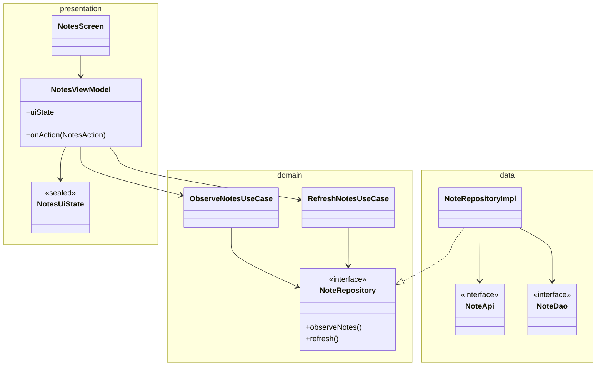
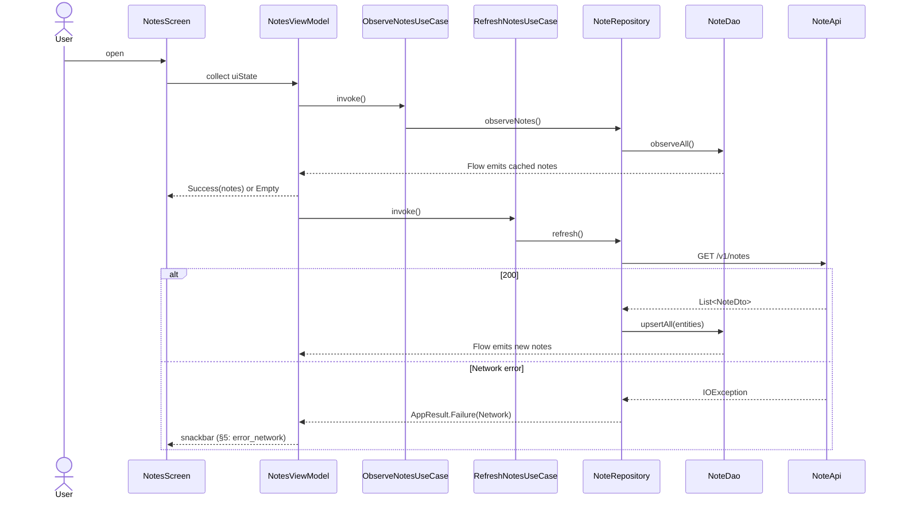

# Feature design: <Feature>
<!-- About 24 KB at most, so a dependent feature can read it in one Read. Signatures and types, not implementations; cite architecture sections instead of restating them. Other features read only §2 Domain. -->

| FR IDs | Owner | Status | UI designs |
|---|---|---|---|
| FR-001, FR-002 | <developer> | Draft | <Figma link> |

## 1. Screens
| Screen | Route (arguments) | States | Notes |
|---|---|---|---|
| Notes list | `NotesRoute` | Loading, Empty, Success, Error | Snackbar when a refresh fails over cached notes |

### <Screen>: state, actions and events
```kotlin
sealed interface NotesUiState { /* Loading, Empty, Success(notes), Error(messageRes) */ }
sealed interface NotesAction { /* user intents sent to the ViewModel */ }
sealed interface NotesEvent { /* transient UI only, e.g. ShowMessage */ }
```
Survives process death: <fields kept in SavedStateHandle>

## 2. Domain
```kotlin
data class Note(val id: String, val title: String, val body: String, val updatedAt: Instant)

interface NoteRepository {
    fun observeNotes(): Flow<List<Note>>
    suspend fun refresh(): AppResult<Unit>
}

class ObserveNotesUseCase { operator fun invoke(): Flow<List<Note>> }
class RefreshNotesUseCase { suspend operator fun invoke(): AppResult<Unit> }
```

## 3. Data
| Endpoint | Request | Response | Errors |
|---|---|---|---|
| `GET /v1/notes` | — | `List<NoteDto>` | 401, 5xx |

- **Room:**
  - entity `NoteEntity` (`id` as the primary key; index on `updatedAt`);
  - DAO `observeAll(): Flow<List<NoteEntity>>`, `suspend fun upsertAll(…)`;
  - migration <n> → <n+1>: <SQL, or "none">.
- **DataStore keys:** <…>
- **Encrypted:** <…>
- **Cache and refresh:** <following the architecture's data strategy>

## 4. Diagrams
<!-- Only when STATUS.md has Design diagrams = On; otherwise write "Off (STATUS.md: Design diagrams)." and keep the heading. The diagrams picture §1–§3 and add no facts: a new class or call goes into §1–§3 first. Names, stereotypes and key public members only; full signatures stay above. About 4 KB for the whole section. Phase 4 KDocs link here. -->

### Class diagram


### Sequence: <flow, e.g. open and refresh the notes list>
<!-- One per primary flow, at most 3 (e.g. load, refresh, save). The failure path goes in an alt block and ends in the behaviour from §5 Errors. -->


## 5. Errors
| AppError | Message (string resource) | UI behaviour |
|---|---|---|
| Network | `error_network` | Error state with Retry; or a snackbar if cached notes are shown |
| Unauthorized | `error_session_expired` | Go to sign-in |

## 6. Analytics
| Event | Parameters | Trigger |
|---|---|---|

## 7. Accessibility and i18n
- Content descriptions
- Headings
- Focus order
- New strings and plurals
- RTL notes

## 8. Test cases
| ID | Level | FR | Case |
|---|---|---|---|
| IT-001 | Integration | FR-001 | Refresh stores the notes; the DAO emits them |
| UI-001 | UI | FR-001 | Empty state shows "Create note", which opens the editor |

## 9. PR slice plan
| # | PR | Layer | Est. changed lines |
|---|---|---|---|
| 1 | Note model, repository interface, UseCases + tests | Domain | ~200 |
| 2 | API, Room, repository implementation + tests | Data | ~350 |
| 3 | UiState, ViewModel + tests | Presentation | ~250 |
| 4 | Screen and content, previews, navigation, DI | Presentation | ~300 |
| 5 | Critical-flow UI test | Test | ~100 |

## 10. Open questions
- <…>
